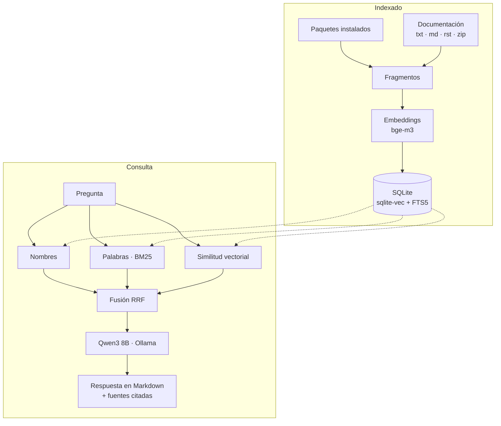

# Cómo funciona

[← README](../README.md)

Todo ocurre en tu máquina: Ollama sirve los modelos y el índice es un único fichero
SQLite con las extensiones `sqlite-vec` (vectores) y FTS5 (texto completo).

## Indexado

1. **Extracción.** Los paquetes se inspeccionan con `inspect` (módulos, clases,
   funciones y propiedades públicas con docstring). La documentación se trocea por
   secciones según sus encabezados.
2. **Fragmentos.** Cada uno guarda paquete, nombre cualificado, firma o título, texto,
   fichero (relativo a la raíz de la fuente) y línea. Los textos largos se dividen en
   partes de ~2000 caracteres sin perder contenido.
3. **Embeddings.** `bge-m3` (1024 dimensiones) convierte cada fragmento en un vector.
4. **Almacén.** Se guardan texto, vector e índice FTS5, y una fila por fuente con su
   tipo, versión, entorno, raíz y fecha.

### Caché de embeddings

Cada fragmento guarda el hash (SHA-256) de su texto. Al reindexar, los fragmentos
cuyo texto ya está en el índice reutilizan su vector y solo los nuevos o cambiados
se envían a Ollama: actualizar un paquete con pocos cambios o repetir
`api index-docs` es casi instantáneo. El índice usa un único modelo de embeddings
(validado al abrirlo), así que el mismo texto siempre tiene el mismo vector.

### Identidad de las fuentes

Una fuente de paquete se identifica por el paquete **y** el entorno desde el que se
indexó. La primera vez recibe el nombre del paquete; si ese nombre ya lo usa el mismo
paquete de otro entorno (o una fuente de documentación), se le añade la etiqueta del
entorno: la carpeta del proyecto que contiene el venv (`zensical@reCocina`) o
`herramienta`. Reindexar desde el mismo entorno sustituye su propia fuente.

## Recuperación

Cada pregunta se busca por cuatro vías, cada una con su peso:

| Señal | Qué busca | Peso |
| --- | --- | --- |
| N | nombres cualificados escritos en la pregunta (`json.dumps`) | 3,0 |
| S | nombres cortos (`dumps`) | 1,5 |
| L | palabras del contenido (BM25 sobre FTS5) | 1,0 |
| V | similitud semántica (distancia entre vectores) | 1,0 |

Los rankings se combinan con **Reciprocal Rank Fusion**: cada fragmento suma
`peso / (60 + posición)` en cada lista donde aparece. Después se limita a
`max_per_symbol` fragmentos de un mismo símbolo, para que un docstring largo no ocupe
todo el contexto, y se eligen los `k` mejores.

`api ask --debug` muestra los candidatos con su puntuación, la posición en cada señal y
la distancia vectorial.

### Abstención

Si se define `[retrieval] max_distance`, la consulta no se responde cuando no hay
coincidencia de nombre y el vecino más cercano supera ese umbral. Así se evita que el
modelo «rellene» con fragmentos poco relacionados. Por defecto está desactivado.

## Respuesta y citas

Los fragmentos elegidos se envían al modelo como contexto numerado (`[DOC-01]`…). El
prompt (en el `Modelfile`) trata ese contexto como única fuente de verdad, le prohíbe
inventar APIs y le exige citar cada una; si no basta, empieza con «Con la documentación
recuperada no puedo confirmarlo». Al terminar se comprueban las citas: las válidas se
marcan con ✔ en el panel «Fuentes» y se avisa de ids inexistentes o de respuestas sin
ninguna cita.

## Integridad del índice

- El índice registra el modelo y la dimensión de los embeddings: con otros distintos se
  niega a insertar o consultar y explica cómo reconstruirlo.
- El formato está versionado (actualmente 5). Un índice anterior se migra solo al
  abrirlo, sin reindexar.
- Las rutas se guardan relativas a la raíz de cada fuente; si la carpeta se mueve,
  `api sources --relocate` la recoloca.
- Al preguntar se compara la versión indexada de cada paquete con la instalada en su
  entorno, y se avisa de las obsoletas.
- La base usa modo WAL: se puede consultar mientras otro proceso indexa. Dos
  indexados a la vez se turnan (cada fuente se escribe en una sola transacción).

## Limitaciones conocidas

- La calidad depende de la documentación: los símbolos sin docstring no se indexan.
- Un docstring repartido en varios fragmentos puede llegar al modelo solo en parte.
- Solo se ve la API que existe tras importar: lo que se crea bajo demanda
  (`__getattr__` de módulo, *lazy imports*, proxies) o vive en extensiones C sin
  docstrings puede faltar.
- Sin `max_distance` siempre se responde con lo recuperado, aunque sea poco relevante.
- La sonda de `--python` necesita Python 3.12+ en el entorno objetivo.
- Un paquete sin metadatos de distribución aparece como «no instalada».
- Cada `api index-docs` vuelve a extraer los `.zip` completos (los embeddings sí
  se reutilizan).
- Indexar la stdlib desde otro intérprete añade sus módulos como fuentes nuevas
  (`json@Poker`): si no quieres ambas versiones, elimina una con
  `api sources -r`.
